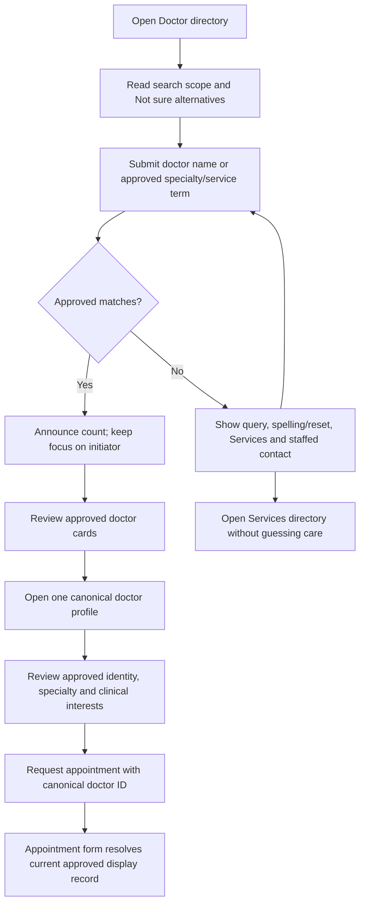
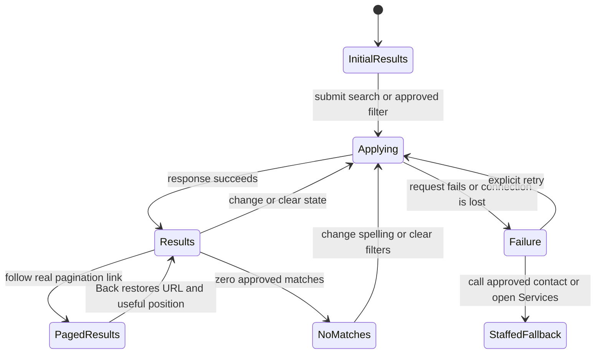
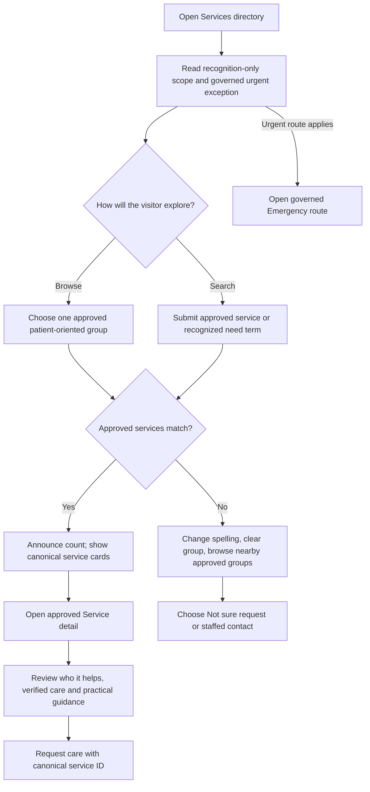
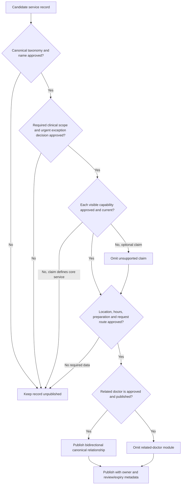
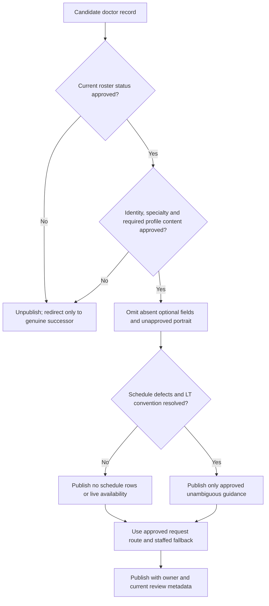
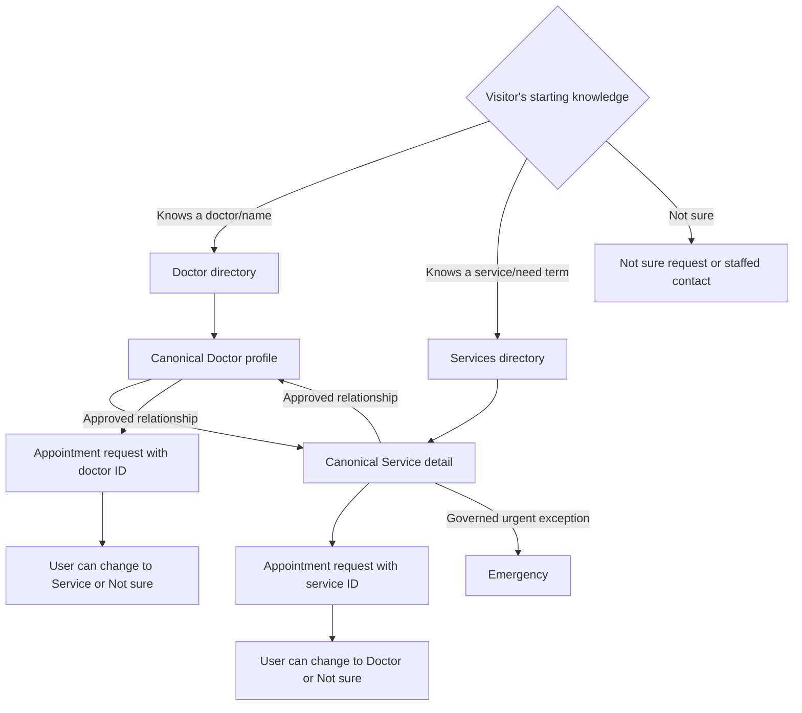
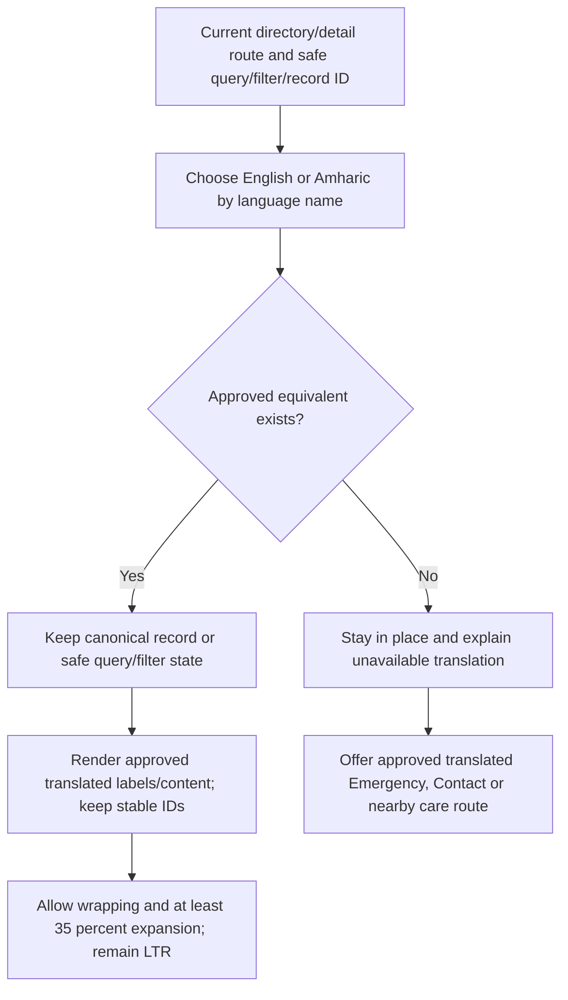

# Care-Discovery User Flows

**Status:** Low-fidelity behavior map; roster, taxonomy, relationships, scope, schedules, contacts, and public copy remain gated  
**Pages in package:** [Doctor directory](doctor-directory.md) · [Doctor profile](doctor-profile.md) · [Services directory](services-directory.md) · [Service detail](service-detail.md)

These flows describe navigation and system state. They do not diagnose, recommend a clinician or treatment, estimate urgency, expose live availability, or confirm an appointment.

## C1 — Find a doctor by name or specialty/service

Text alternative: The visitor submits a name or approved specialty/service term. Matching approved doctors appear with an announced count and one canonical profile link each. A profile can hand its stable public doctor ID to the appointment request. With no match, the visitor can edit/reset, explore Services, or use staffed contact; the site does not diagnose or recommend a clinician.

**Requirements:** `D-001`–`D-006`, `V-001`, `A-001`–`A-003`, `C-001`, `G-005`, `G-011`, `G-013`–`G-015`.

## C2 — Doctor filter, paging, and recovery

Text alternative: Search, filter, and page state is encoded in the URL. Committed changes announce results while focus stays on the initiating control. No-match and failure states retain the query and offer reset/retry plus safe alternatives. Browser Back/Forward restores the state; no infinite scroll is required.

**Requirements:** `D-002`, `G-005`, `G-007`, `G-011`–`G-013`, `H-005`, `C-001`.

## C3 — Browse or search services

Text alternative: A visitor browses the single approved patient taxonomy or searches approved service/need terms. Results lead to canonical service details containing only approved scope and practical guidance. Request care passes the public service ID. No matches lead to reset, approved groups, Not sure, or staffed contact—not a diagnosis. Governed urgent guidance routes to Emergency before ordinary discovery.

**Requirements:** `V-001`–`V-005`, `H-005`, `E-001`–`E-003`, `A-001`–`A-003`, `C-001`, `G-011`–`G-015`.

## C4 — Service capability, relationship, and availability gates

Text alternative: A service publishes only after the canonical taxonomy, required scope, urgent-exception decision, operational/request information, owner, and review metadata are approved. Optional unsupported claims and relationships are omitted. A capability central to the service's identity or missing required data keeps the record unpublished. Related doctor links appear only when both canonical records are current.

**Requirements:** `V-001`–`V-005`, `D-001`–`D-004`, `G-013`–`G-015`, `C-001`–`C-003`.

## C5 — Doctor profile publication and schedule boundary

Text alternative: Current roster and required profile identity/content are prerequisites. Optional fields disappear cleanly. Until the duplicate Saturday, missing Sunday, and `LT` issues are resolved, schedules and live availability are omitted; the profile may use only approved general request guidance and a staffed fallback. Retired records redirect only to genuine approved successors.

**Requirements:** `D-001`, `D-003`–`D-006`, `G-013`–`G-015`, `A-001`–`A-003`, `C-001`.

## C6 — Move safely between doctor and service discovery

Text alternative: Visitors can start with a known doctor, a known service/need term, or Not sure. Only governed relationships connect profiles and services. Either detail page may preselect one public canonical ID in the appointment request, where the visitor remains free to change route. Urgent exceptions use approved Emergency guidance and never arise from inferred symptoms.

**Requirements:** `D-002`–`D-004`, `V-001`, `V-002`, `V-005`, `A-001`–`A-003`, `E-001`–`E-003`.

## C7 — Language and canonical-state continuity

Text alternative: A language switch keeps the same canonical record and safe directory state only when the equivalent is approved. Identifiers do not change or get translated. Missing content is explained in place, never redirected silently to Home. English and Amharic layouts remain left-to-right and permit wrapping/expansion.

**Requirements:** `S-006`–`S-008`, `G-003`, `G-010`–`G-011`, `D-002`–`D-004`, `V-001`–`V-002`.

## Cross-page navigation outcomes

| From | Action | Outcome | Continuity and safety rule |
| --- | --- | --- | --- |
| Doctor directory | Search/filter/page | Same route with safe URL state | Back/Forward/refresh/share reproduce state; focus remains on initiator and count announces. |
| Doctor card | View profile | `/doctors/{approved-slug}/` | One canonical URL; Back restores directory state/position where supported. |
| Doctor profile | Request appointment | `/appointments/?doctor={canonical-id}` | Public ID only; form resolves current label and allows route change; no schedule promise. |
| Doctor profile | Related service | `/services/{approved-slug}/` | Only when both records and bidirectional relationship are approved. |
| Services directory | Search/group/page | Same route with safe URL state | Approved terms only; no sensitive-query analytics without approval. |
| Service card | Learn about service | `/services/{approved-slug}/` | One canonical URL; Back restores directory state/position. |
| Service detail | Request care | `/appointments/?service={canonical-id}` | Public ID only; no symptoms/notes in URL; request is not booking. |
| Service detail | Related doctor | `/doctors/{approved-slug}/` | Current approved roster only; no live availability claim. |
| Any discovery page | Emergency | `/emergency/` or approved explicit call action | Safety route is immediate and cannot be blocked by unsaved non-PII directory state. |
| Any discovery page | Language | Equivalent route/state or in-place limitation | Stable IDs/state; approved translation only; never silently Home. |

## Flow-level acceptance review

- [ ] Only approved current doctors and approved launch services appear; unapproved/expired records do not leak through search, filters, cards, relationships, or appointment selectors.
- [ ] Search supports required fields/approved synonyms; only maintained filters appear; URL, Back/Forward, refresh, pagination, and shared links preserve safe state.
- [ ] Result counts are announced after committed actions; no-match and failure states retain context and offer reset/retry plus truthful human/service alternatives.
- [ ] Cards and relationships use one canonical destination; duplicates, stale endpoints, and circular-only journeys are absent.
- [ ] Doctor profiles omit schedules/live availability until `D-005` is resolved and never infer credentials, languages, pronouns, or portraits.
- [ ] Service pages withhold unapproved capabilities and do not diagnose, recommend treatment, or estimate urgency.
- [ ] Detail-to-appointment handoff carries only a stable public record ID, never visitor data, symptoms, notes, or free-text display labels alone.
- [ ] Governed emergency exceptions precede ordinary discovery and are available in approved Amharic; search itself is not triage.
- [ ] Keyboard, screen reader, touch, 320 px/400% zoom, long bilingual content, no-JS, offline/failure, reduced-motion, and constrained-network paths are testable.
- [ ] Every roster, taxonomy, relationship, scope, capability, location, hour, contact, urgent exception, translation, and review claim remains a visible approval gate until signed off.
