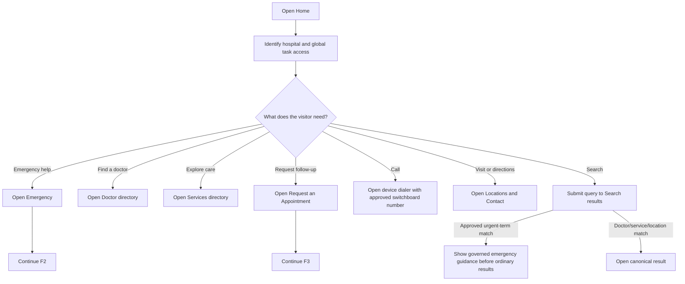
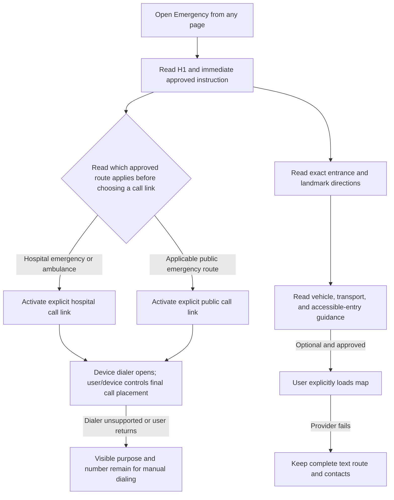
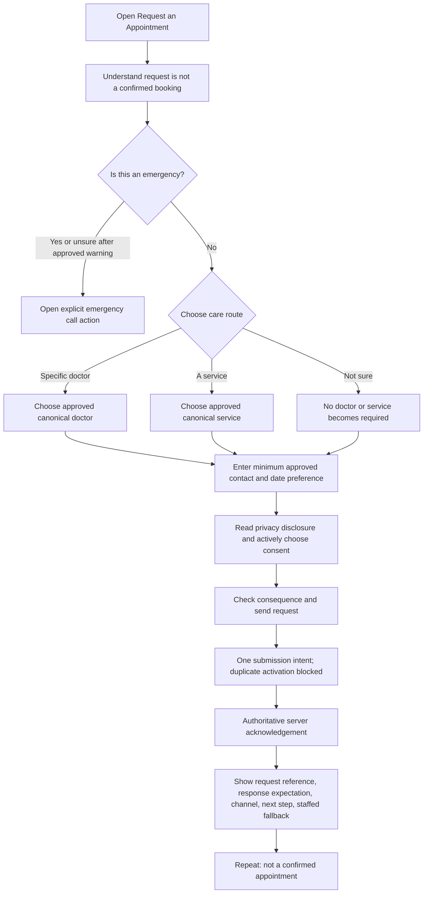
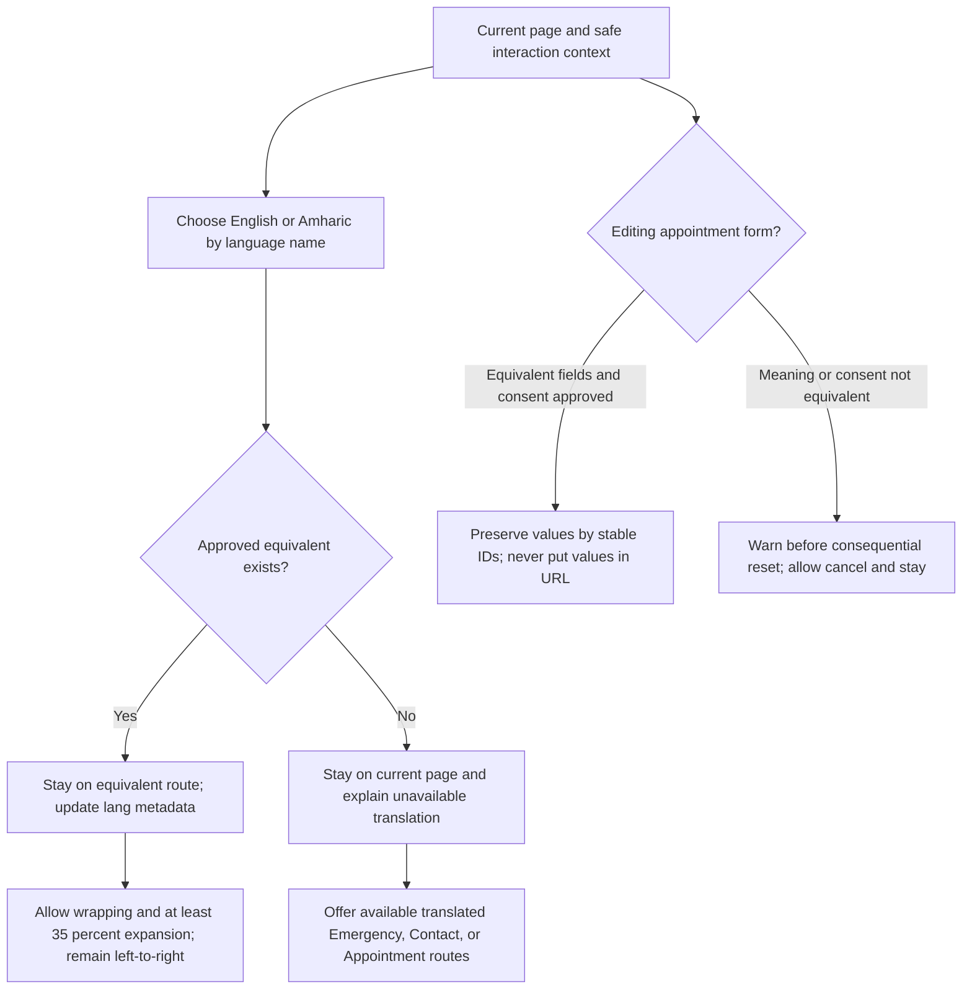

# Critical User Flows

**Status:** Low-fidelity behavior map; operational facts and public copy remain gated  
**Pages in package:** [Home](home.md) · [Emergency](emergency.md) · [Request an Appointment](appointment.md)

These diagrams describe navigation and system state, not diagnosis, urgency assessment, a confirmed booking, or production implementation. Bracketed approvals in the page wireframes remain binding.

## F1 — Home routes into essential journeys

Text alternative: Home exposes Emergency, Doctor, Services, Appointment, Call, Locations/Directions, and Search before any promotional content. Search routes only to governed content; an approved urgent-term match presents emergency guidance without diagnosing or estimating urgency.

**Requirements:** `G-001`, `G-002`, `H-001`–`H-005`, `E-001`, `C-001`, `C-002`, `D-001`–`D-003`, `V-001`.

## F2 — Emergency call and arrival flow

Text alternative: A concise hospital-versus-public route distinction follows the heading before or within the first call-choice group. The visitor chooses between clearly distinguished approved routes, activates only the relevant labeled call link, and remains in control through the device dialer. Arrival guidance is complete as text; an optional map cannot remove it.

**Accidental-activation guard:** the call never fires from page load, focus, the surrounding card, pointer-down, or touch-down. Targets are explicit, at least 44 by 44 CSS px, separated by at least 8 px, and keep the visible number available.

**Requirements:** `G-003`–`G-007`, `G-010`–`G-012`, `E-001`–`E-005`, `C-001`–`C-003`, `S-005`, `S-006`.

## F3 — Appointment request happy path

Text alternative: After a not-for-emergencies boundary, the visitor selects exactly one care route. Only the matching doctor or service field is required; Not sure requires neither. The visitor enters the approved minimum, reads privacy information, actively consents, and sends one protected submission intent. Only a server acknowledgement produces a “request received” reference.

**Requirements:** `A-001`–`A-007`, `S-003`–`S-006`, `E-001`, `D-001`–`D-003`, `V-001`, `C-001`.

## F4 — Appointment validation, timeout, and recovery

```mermaid
stateDiagram-v2
    [*] --> Editing
    Editing --> ValidationError: invalid submit
    ValidationError --> Editing: focus summary, follow field links, retain valid data
    Editing --> Pending: valid submit with one intent key
    Pending --> Received: accepted and acknowledged
    Pending --> Rejected: authoritative recoverable failure
    Pending --> Reconciling: timeout, offline, or acknowledgement lost
    Rejected --> Pending: explicit safe retry with same intent
    Reconciling --> Received: existing accepted request found
    Reconciling --> Pending: not created; safe retry with same intent
    Received --> Success: confirmation channel delivered
    Received --> DeliveryWarning: confirmation delivery failed
    DeliveryWarning --> [*]: show same reference and staffed fallback; do not resubmit
    Success --> [*]
```

Text alternative: Invalid input returns to editing with a focused error summary and retained values. A valid submission enters Pending with one submission identity. A known rejection can retry safely. Unknown outcomes reconcile before retrying. An accepted request always keeps its original reference; a confirmation-message failure is not treated as a failed request and must not invite resubmission.

**Requirements:** `A-004`, `A-006`, `A-007`, `G-005`, `G-007`, `G-011`, `G-012`, `S-003`.

## F5 — Language switching across the critical journey

Text alternative: Both languages are left-to-right. Switching keeps the same route whenever an approved equivalent exists. Missing translation is explained in place rather than redirecting Home. Appointment values are preserved only when field and consent meanings are equivalent; otherwise the user is warned before loss.

**Requirements:** `S-006`–`S-008`, `G-003`, `G-010`, `G-011`, `A-004`, `A-005`.

## Cross-page navigation outcomes

| From | Action | Outcome | Back/continuity rule |
| --- | --- | --- | --- |
| Home | Emergency | `/emergency/` | Browser Back returns to prior Home scroll position where supported. |
| Home | Request an appointment | `/appointments/` | Fresh form unless an approved secure draft mechanism exists; no PII in URL. |
| Appointment warning | Call emergency | Approved `tel:` from explicit link | Form data is not submitted or copied into call/analytics; returning keeps safe local form state where platform permits. |
| Appointment shell | Emergency page | `/emergency/` | A navigation-away warning is allowed only for genuinely entered data and must not trap the user in a safety situation. Emergency route must remain immediate. |
| Appointment success | Home/Doctors/Services | Canonical route | Back/refresh must not resubmit POST; use POST/redirect/GET or equivalent safe acknowledgement pattern. |
| Emergency | Non-emergency contact | `/contact/` | Link is clearly subordinate and labeled non-emergency. |
| Any of the three | Language switch | Same equivalent route or in-place limitation | Preserve route/query/safe state; never silently redirect Home. |

## Flow-level acceptance review

- [ ] From Home, each essential route is visible or predictably available on mobile and desktop before promotion.
- [ ] Emergency call actions use approved matching visible/normalized numbers and pass accidental-activation tests.
- [ ] Emergency entrance/directions work without JavaScript, map, images, or custom fonts.
- [ ] Appointment branching never requires Doctor and Service together; Not sure remains a valid route.
- [ ] Invalid, timeout, offline, rejected, duplicate, recovered-acknowledgement, received, and message-delivery-failure paths retain truthful state.
- [ ] No appointment success message implies booking confirmation.
- [ ] Browser Back/Forward and refresh do not create duplicate requests or lose safe state unexpectedly.
- [ ] English/Amharic switching retains context, reflects left-to-right direction, allows expansion, and explains unavailable parity.
- [ ] Every fallback number, staffing statement, response expectation, confirmation channel, clinical warning, and privacy statement remains a visible approval gate until signed off.
