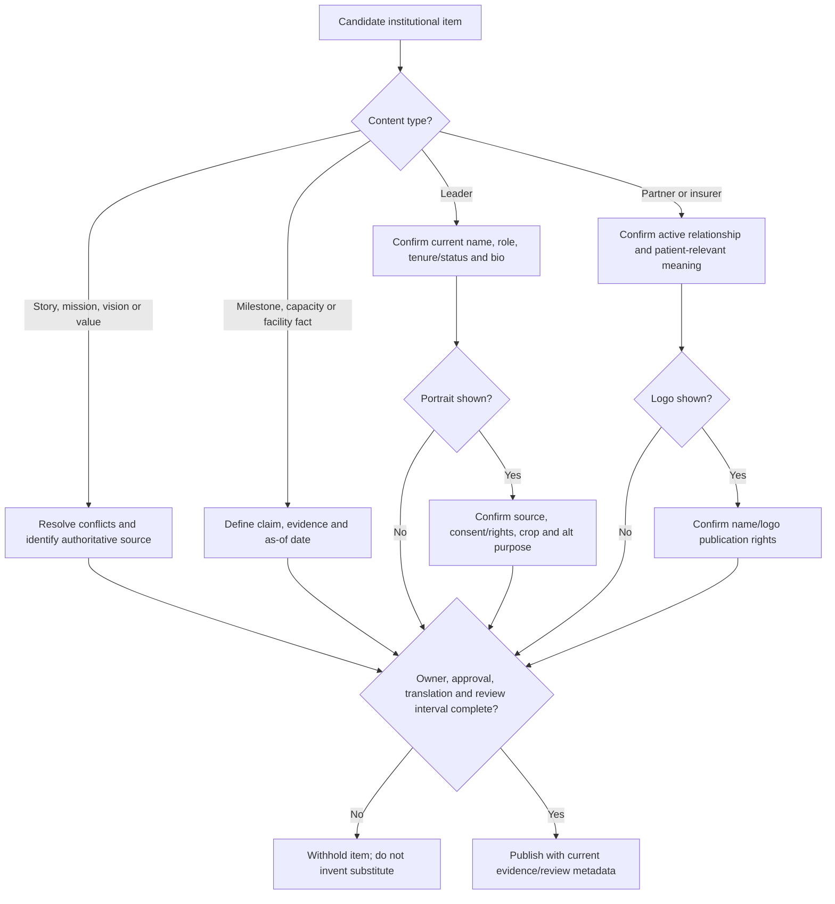
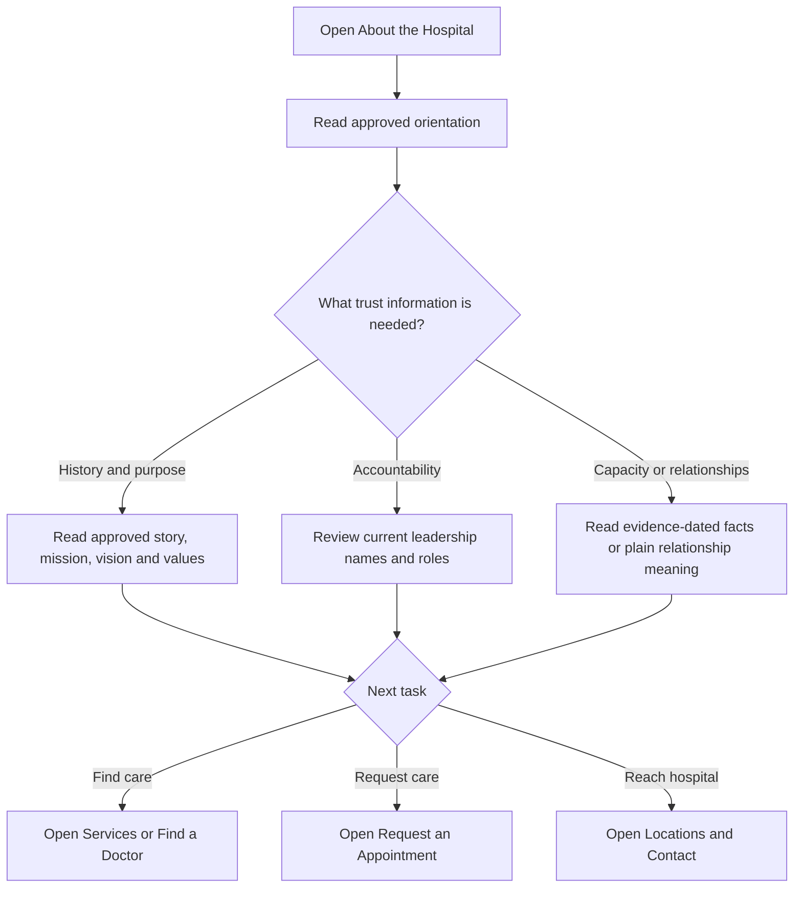
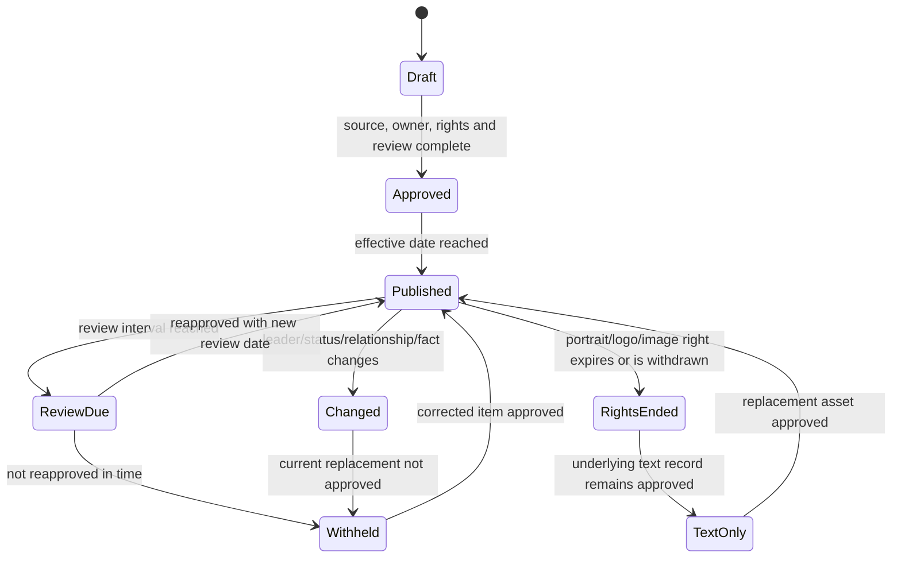
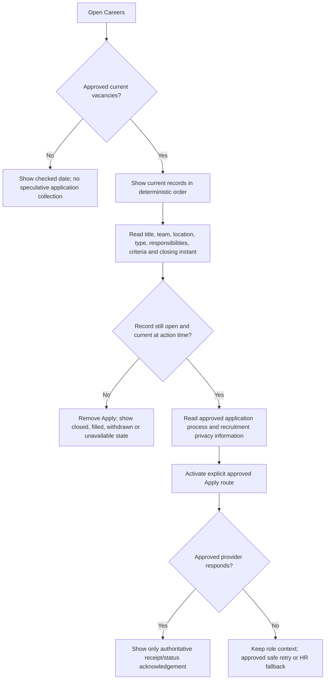
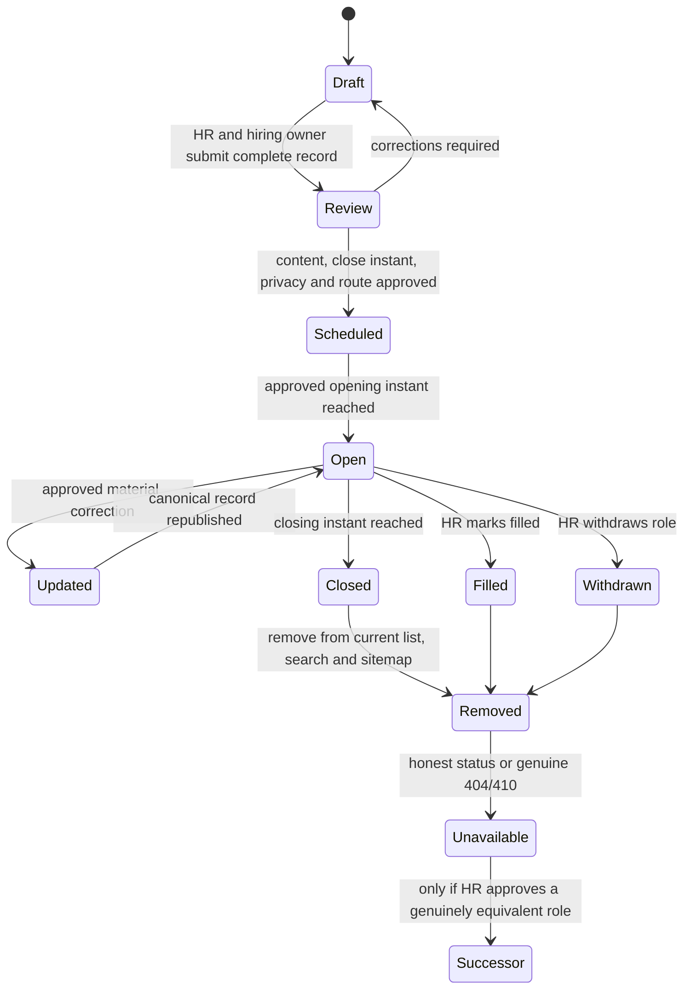
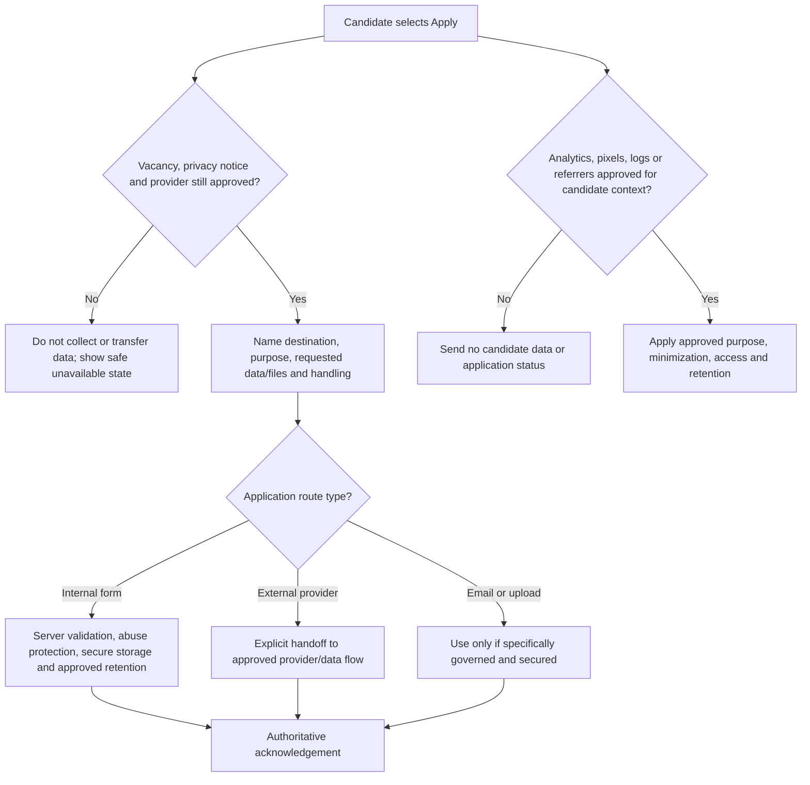
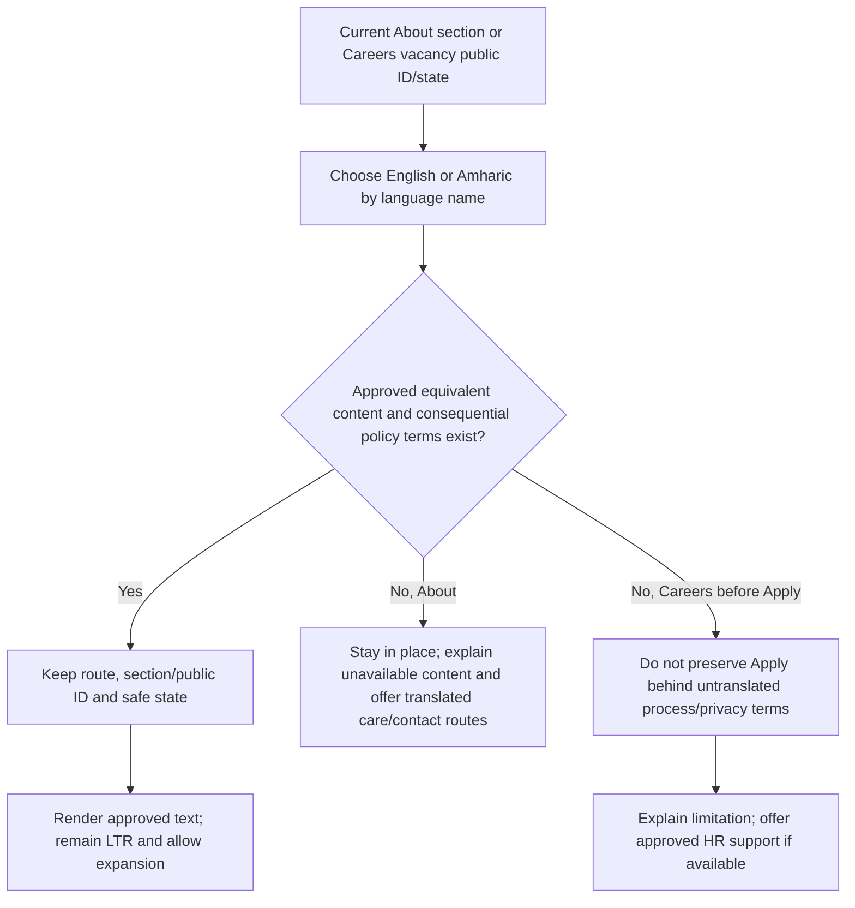

# Institutional Content and Vacancy Lifecycle Flows

**Status:** Low-fidelity behavior map; institutional claims, leadership, relationships, vacancy data, recruitment policies, application handling, translations, and imagery remain gated  
**Pages in package:** [About the Hospital](about.md) · [Careers](careers.md)

These flows define publication and navigation behavior. They do not approve a hospital claim, partner/insurer relationship, leader, vacancy, equality policy, application channel, privacy basis, translation, or image right.

## I1 — About-content publication gate

Text alternative: Each narrative, claim, leadership record, or relationship must have an authoritative source, approval, translation decision, owner, and review interval. Portraits and logos add explicit rights checks. Incomplete items are withheld without generic substitutes.

**Requirements:** `I-001`–`I-003`, `H-004`, `G-010`, `G-014`–`G-015`, `S-005`–`S-008`.

## I2 — Institutional trust returns to patient tasks

Text alternative: The visitor reads only approved institutional information, then can move directly to Services, Doctors, the appointment request, or Contact. Institutional storytelling never becomes the only route or pushes essential patient tasks out of reach.

**Requirements:** `G-001`–`G-002`, `I-001`–`I-003`, `D-001`–`D-003`, `V-001`–`V-003`, `A-001`, `C-001`–`C-003`.

## I3 — Claim, relationship, leadership, and asset expiry

Text alternative: Published institutional content is rechecked on schedule and whenever its underlying fact, person, relationship, or usage right changes. Stale content is withheld. Loss of image/logo rights can produce a text-only record only when the underlying text remains approved.

**Requirements:** `G-014`–`G-015`, `H-004`, `I-001`–`I-003`.

## I4 — Current-vacancy application path

Text alternative: Careers either shows an honest no-vacancy state or complete approved current roles. Before applying, the candidate reads the process and privacy terms. The record is rechecked when Apply is used. Only the approved provider can acknowledge receipt; failures do not route candidate data into an ungoverned alternative.

**Requirements:** `I-004`, `S-002`–`S-005`, `G-005`, `G-007`, `G-011`, `G-014`–`G-015`.

## I5 — Vacancy lifecycle and stale-destination behavior

Text alternative: A vacancy moves from draft through review and scheduling to open only when its content, timing, privacy disclosure, and application route are approved. At closing, filling, or withdrawal, Apply is removed and the record leaves current lists, search, and sitemaps. Old destinations show an honest status or 404/410; redirection needs a genuinely equivalent HR-approved successor.

**Requirements:** `I-004`, `G-011`, `G-013`–`G-015`.

## I6 — Candidate-data and third-party boundary

Text alternative: The system rechecks the vacancy, privacy notice, and application provider before collecting or transferring data. Internal forms, external providers, email, and uploads each require explicit handling approval. Candidate data or application status does not enter unapproved analytics, logs, pixels, or referrers.

**Requirements:** `S-002`–`S-005`, `I-004`, `G-007`–`G-009`, `G-014`–`G-015`.

## I7 — English/Amharic institutional continuity

Text alternative: Language switching preserves the About section or vacancy public ID only when an approved equivalent exists. Missing About content is explained in place. A Careers application action is not carried into a language where consequential process or privacy terms are unavailable. Both languages remain left-to-right and allow expansion.

**Requirements:** `S-006`–`S-008`, `G-003`, `G-010`–`G-011`, `I-001`–`I-004`.

## Cross-page navigation outcomes

| From | Action | Outcome | Continuity and governance rule |
| --- | --- | --- | --- |
| Home/footer | About the Hospital | `/about/` | Route appears only with an approved minimum institutional narrative; no unapproved Home trust excerpt. |
| About | Explore services / Find a doctor | `/services/` or `/doctors/` | Current approved care records only; institutional claims do not determine clinical suitability. |
| About | Request appointment / Contact | `/appointments/` or `/contact/` | Existing request/contact gates continue to apply; About does not duplicate independent contact facts. |
| Footer/secondary navigation | Careers | `/careers/` | Phase 2 route appears only when HR maintains the lifecycle and application/privacy handling is approved. |
| Careers | Jump to current vacancies | `/careers/#current-vacancies` | Real heading target; no JavaScript dependency; reduced motion does not smooth-scroll. |
| Vacancy | Apply | Approved internal route or clearly labeled external provider | Public vacancy ID only; no candidate data in URL; approval/status rechecked at activation. |
| Old vacancy destination | View current vacancies | `/careers/#current-vacancies` | Apply removed; no silent redirect to an unrelated job. |
| Institutional page | Language | Equivalent route/section/public ID or in-place limitation | Approved content only; no silent Home redirect; untranslated consequential terms block Apply. |

## Flow-level acceptance review

- [ ] About publishes only after the conflicting mission is resolved and the required story, mission, vision, values, leadership, owner, evidence, translation decision and review interval are approved.
- [ ] Every milestone, capacity/facility fact and extracted superlative has a defined claim, source, as-of date, owner and current approval; unverified items are absent rather than softened or generalized.
- [ ] Leadership records are current; biographies and portraits are optional and disappear cleanly when absent or rights-expired.
- [ ] Each partner/insurer entry explains the exact current patient-relevant relationship and limitations; names/logos have rights and do not imply unapproved coverage or endorsement.
- [ ] About retains Services, Doctors, Appointments and Contact as clear next steps and works without imagery, scripts, custom fonts or promotional motion.
- [ ] Careers remains deferred until HR demonstrates creation, approval, opening, updating, closing/withdrawal/filling, removal, response and review ownership.
- [ ] Every current vacancy has a stable public ID, required fields, exact closing instant/timezone, approved application route, privacy terms and owner; stale records cannot remain actionable through cache or direct links.
- [ ] Closed, filled and withdrawn records lose Apply and leave current lists, search and sitemaps; old destinations use an honest status/404/410 and only genuine approved successor redirects.
- [ ] No-current-role states collect no speculative applications. Internal forms, mailboxes, uploads, external providers, analytics and logs receive no candidate data without explicit approval.
- [ ] Equal-opportunity, accessibility/accommodation, response, fraud-warning and recruitment claims are approved rather than borrowed or inferred.
- [ ] Keyboard, screen reader, touch, 320 px/400% zoom, long English/Amharic text, unavailable translation, no JavaScript/media, third-party failure, reduced motion and constrained-network paths are testable.
