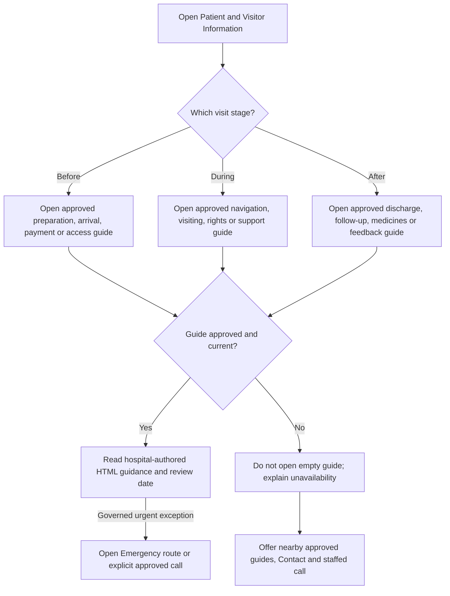
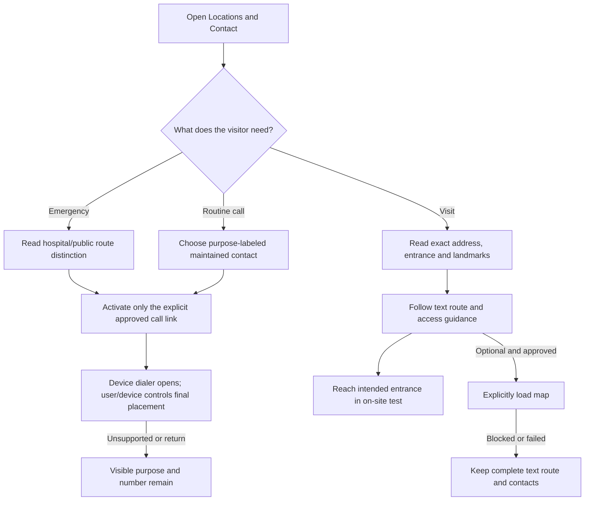
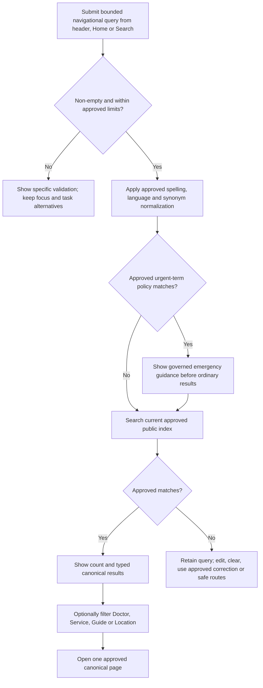
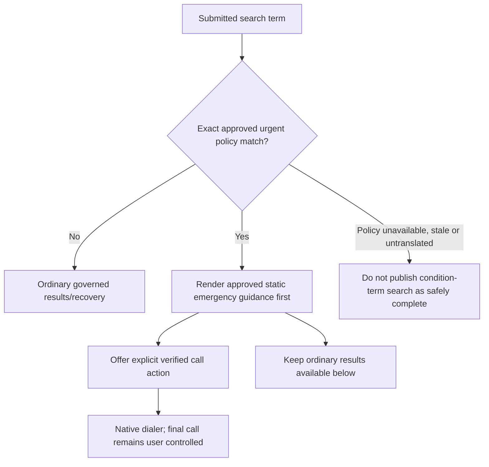
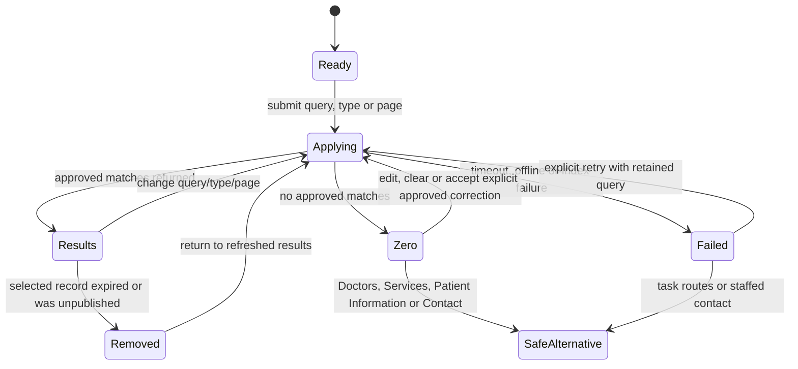
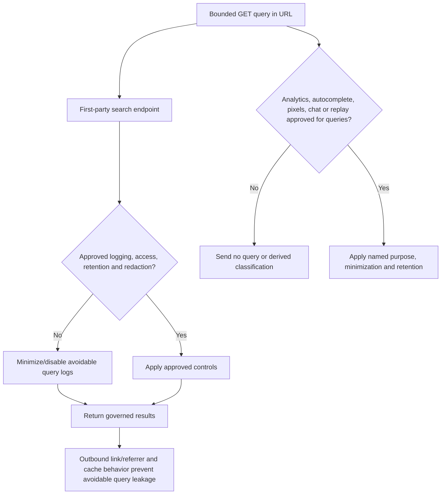
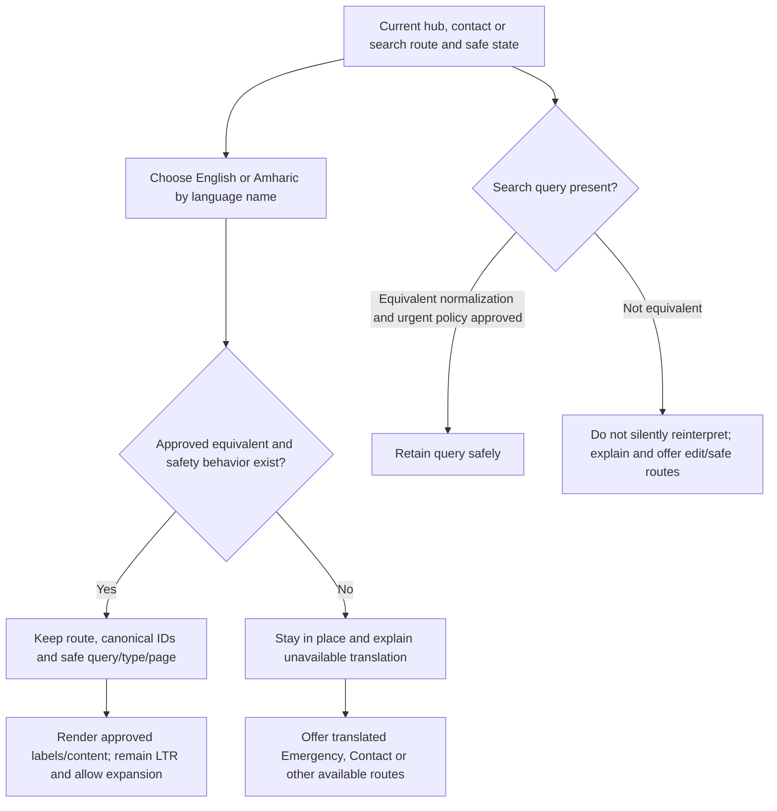

# Practical-Access and Site-Search User Flows

**Status:** Low-fidelity behavior map; guidance, contacts, hours, directions, taxonomy, urgent terms, privacy handling and translations remain gated  
**Pages in package:** [Patient & Visitor Information](patient-information.md) · [Locations & Contact](locations-contact.md) · [Search Results](search-results.md)

These flows describe navigation and system state. They do not provide medical advice, infer a condition, estimate urgency, approve an operational fact, or make third-party query collection acceptable.

## PA1 — Prepare for, navigate and complete a visit

Text alternative: The visitor chooses Before, During or After, then opens only a current hospital-authored guide. An unavailable topic does not create an empty page; it offers valid nearby guidance and staffed contact. Any urgent exception is governed and routes to Emergency without diagnosing.

**Requirements:** `P-001`, `P-002`, `G-007`, `G-011`, `G-014`, `G-015`, `C-001`, `E-001`–`E-003`.

## PA2 — Call the correct purpose and arrive without a map

Text alternative: Call purposes are separated and only explicit links open the dialer. Arrival uses approved address, entrance, landmarks and text steps before any map. A failed or blocked map leaves the journey complete.

**Requirements:** `C-001`–`C-003`, `E-001`–`E-005`, `G-003`–`G-007`, `S-005`, `S-006`.

## PA3 — Detailed site-search happy path

Text alternative: A submitted query is validated and normalized only with approved bilingual vocabulary. An urgent-term match adds emergency guidance before searching the current public index. Results are typed and canonical; zero results retain context and offer safe alternatives.

**Requirements:** `H-005`, `G-005`, `G-007`, `G-010`–`G-015`, `E-001`–`E-003`, `D-001`–`D-004`, `V-001`–`V-005`, `P-001`–`P-002`, `C-001`–`C-002`.

## PA4 — Urgent-term boundary without diagnosis

Text alternative: Only an approved policy can trigger static emergency guidance. The message does not state that the visitor has an emergency and does not suppress ordinary results. If the urgent policy is unavailable or stale, the gated search capability is not presented as release-ready.

**Requirements:** `H-005`, `E-001`–`E-005`, `S-006`–`S-008`, `G-014`, `G-015`.

## PA5 — Search correction, zero results and failure recovery

Text alternative: Committed changes retain URL state. Corrections require explicit acceptance. Zero and failure states never guess a diagnosis; they offer editing, retry and safe task/contact routes. Unpublished records are removed from the index rather than leaked as stale results.

**Requirements:** `H-005`, `G-007`, `G-011`, `G-013`–`G-015`, `C-001`.

## PA6 — Search query privacy and dependency boundary

Text alternative: The first-party GET query supports navigation continuity but is treated as potentially sensitive. Logging, retention, cache and referrer behavior require approval. No third party receives the query or a derived health classification without a documented reviewed purpose; search works without those dependencies.

**Requirements:** `S-002`, `S-005`, `G-007`–`G-009`, `H-005`.

## PA7 — English/Amharic practical-access continuity

Text alternative: Language switching preserves context only where content and safety behavior are equivalent. Search does not silently reinterpret a term under a different urgent policy. Missing translation is explained in place with safe translated alternatives; both languages remain left-to-right.

**Requirements:** `S-006`–`S-008`, `G-003`, `G-010`–`G-011`, `H-005`, `C-001`–`C-002`, `P-001`–`P-002`.

## Cross-page navigation outcomes

| From | Action | Outcome | Continuity and safety rule |
| --- | --- | --- | --- |
| Home/header | Search | `/search/?q={bounded-query}` | GET works without JS; no personal-detail prompting; Back returns to prior context. |
| Search | Open result | Canonical doctor/service/guide/location route | Result must be approved/current; Back restores query, type, page and useful position. |
| Search urgent guidance | Emergency | `/emergency/` or explicit approved `tel:` | Guidance precedes results, never diagnoses, and call cannot fire from the surrounding alert. |
| Patient hub | Open guide | Maintained child route/deep link | Missing guide produces truthful recovery, never an empty category page. |
| Patient guide | Directions/contact | `/contact/` or maintained heading deep link | Canonical access data only; no duplicated independent values. |
| Contact | Call | Approved explicit `tel:` | Purpose and visible number remain; native dialer/user controls final placement. |
| Contact | Load map | Approved map provider/external route | Explicit action only; text directions remain complete when blocked or failed. |
| Any package page | Language | Equivalent route/state or in-place limitation | Preserve only safe equivalent state; never silently redirect Home or reinterpret urgency. |

## Flow-level acceptance review

- [ ] Patient guidance exposes only approved, owned and current topics; empty stages/pages and expired guides are absent from navigation and search.
- [ ] Contact uses one canonical record for every repeated number, address, hour and entrance; call values match visible values and activation is explicit.
- [ ] Written arrival directions pass an on-site test without a map; map failure and no JavaScript leave the route complete.
- [ ] Search indexes only public approved records, labels every result type, links canonically, and removes unpublished/expired records without leakage.
- [ ] Approved bilingual synonyms, spelling variants, correction behavior, ranking tasks and urgent-term policy pass relevance tests without diagnosing or estimating urgency.
- [ ] Urgent guidance precedes ordinary results, remains through filtering/paging and uses an approved explicit call route.
- [ ] Query, type and page state survive GET, refresh, Back/Forward and sharing, while privacy controls prevent avoidable log, third-party, referrer and cache leakage.
- [ ] Zero, failure, offline, unavailable translation and no-JavaScript states retain context and offer safe task/staffed alternatives.
- [ ] Keyboard, screen reader, touch, 320 px/400% zoom, long English/Amharic content, reduced motion and constrained-network behavior are testable.
- [ ] Missing guidance, contacts, hours, entrance/directions, taxonomy, urgent terms, analytics/log handling and translations remain explicit approval gates.
